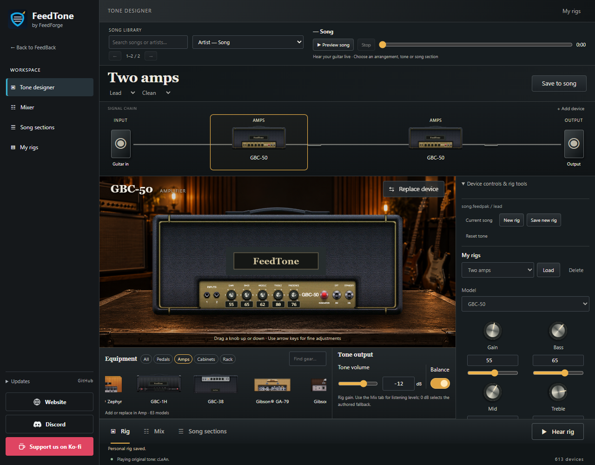

# FeedTone

### by FeedForge

A guitar tone designer inside **FeedBack**. Build your own rigs, preview a song's
arrangements and sections, and save guitar and backing levels for each song.

- Real device faces with live controls and a drag-and-drop signal chain.
- Amps, cabinets, pedals and rack effects, including custom device order.
- Song tone following, personal rigs, and section-specific tone or mix edits.
- Gentle tone balancing and GitHub updates after FeedBack closes.

Install this repository through FeedBack's Plugin Manager, or get the plugin ZIP
from [Releases](https://github.com/balki97/FeedTone/releases/latest). Restart FeedBack
after installation. No separate FeedTone application is needed.

Supports FeedBack desktop on Windows, macOS (Intel and Apple Silicon), and Linux
(Intel and ARM), using 44.1 or 48 kHz audio and the embedded Python 3.12 runtime. Linux
requires glibc; actual audio-interface listening still depends on the host's device
support. Complete acoustic equivalence is not claimed.

If the guitar is silent, expand **No sound? Check audio setup** in the designer
or in-song panel for monitoring, sample-rate and Follow Song guidance.

For USB devices with multiple inputs, select a dry/DI guitar input. Shared-mode
song previews follow the default or matched browser output; exclusive outputs use
the desktop audio engine.

Keep only one FeedTone installation and disable Rig Builder while using it.
Existing installations can update in place through GitHub. Personal rigs and mix
edits are stored in FeedBack's settings.

[Website](https://feedforge.org) · [Discord](https://discord.gg/9cUe6cacQN) ·
[Support us on Ko-fi](https://ko-fi.com/feedforge)
